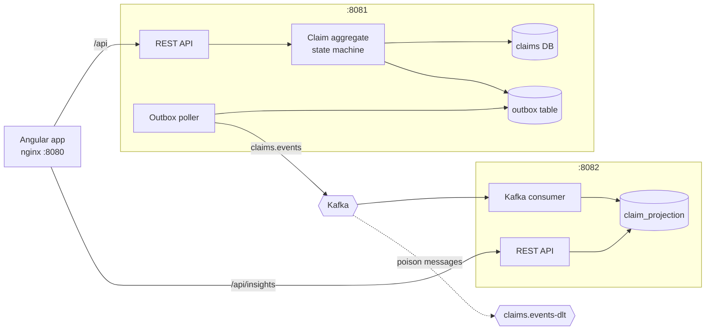
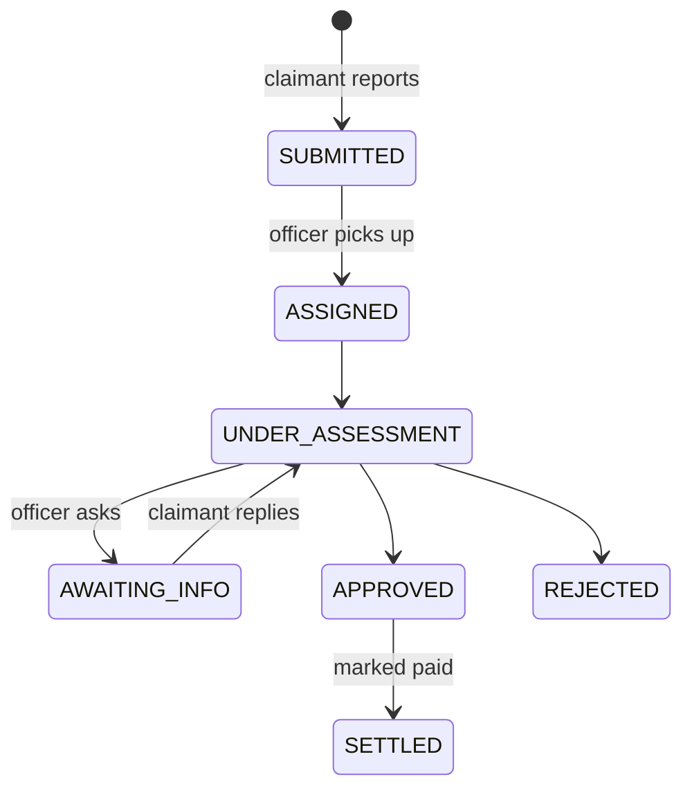

# Claims Platform

Motor and property claims for six APAC markets. Claimants report incidents, track progress and answer questions from their claims officer. Claims staff pick up work from team queues, assess, request information, set reserves, and approve or reject. Managers see outstanding liability and team workload in near real time.

## Run it

Requires Docker Desktop.

```bash
docker compose up --build
```

First build takes a few minutes (Maven and npm downloads). Then open **http://localhost:8080** and pick a demo account. Demo claims in every state are seeded on first start.

| URL | What |
|---|---|
| http://localhost:8080 | Angular app |
| http://localhost:8081/swagger-ui/index.html | Claims API |
| http://localhost:8082/swagger-ui/index.html | Insights API |

Stop with `Ctrl+C`, then `docker compose down` (add `-v` to wipe data and reseed next time).

### Demo accounts

| Account | Role | Sees |
|---|---|---|
| Aisha Rahman, Ben Tan | Policyholder | Own claims only |
| Lim Hui Min, Raj Kumar | Claims officer, MY-MOTOR | MY-MOTOR queue and claims |
| Wei Ling | Claims officer, SG-PROPERTY | SG-PROPERTY queue and claims |
| Grace Wong | Claims manager | Everything, plus exposure dashboard |

## Architecture



- **claims-service** is the system of record. Every user action is a synchronous REST command validated by the `Claim` aggregate. The state change and its event are written in one transaction (outbox), then published to Kafka.
- **insights-service** consumes `claims.events` and keeps a per-claim projection for exposure and workload queries. It never touches the claims database.
- **web** is one Angular app with two lazy-loaded, role-guarded areas (`/claimant`, `/staff`).

**REST vs Kafka in one line:** if a person is waiting for the answer, it's REST; if it's a fact other parts of the business might care about later, it's Kafka. Full reasoning in [`docs/DECISIONS.md`](docs/DECISIONS.md).

### Claim lifecycle



Reserve (expected cost) starts at the claimant's estimate, is revised during assessment, becomes the agreed amount on approval, and drops to zero on settlement or rejection. Outstanding liability = sum of reserves on open claims.

## Demo script (about 5 minutes)

1. **Aisha** reports a motor incident. Show the progress rail and plain-language status.
2. **Hui Min** sees it in the MY-MOTOR queue, picks it up, starts assessment, adjusts the reserve, asks the claimant for a photo.
3. **Aisha** refreshes: the rail is amber ("Needs your input"); she replies inline.
4. **Hui Min** approves. **Grace**'s dashboard shows the MYR exposure change within seconds, with the freshness line.
5. Concurrency: open the queue as **Raj** in a second browser, pick up a claim as Hui Min first, then click Pick up as Raj → "Claim already picked up by Lim Hui Min".
6. Swagger: show a 409 for an invalid transition and a 404 for a claim outside your team.

## Tests

```bash
mvn verify                      # 21 backend tests: domain rules, API, outbox→Kafka, projection (needs Docker for Postgres)
cd web && npx ng test --watch=false   # 9 frontend unit tests
```

Integration tests run against a real Postgres (Testcontainers) and an in-process Kafka broker. Notable cases: two handlers racing to pick up the same claim, duplicate and out-of-order events, a poison message going to the dead-letter topic.

## Local development without Docker for the apps

```bash
docker compose up -d postgres kafka
mvn -pl claims-service spring-boot:run -Dspring-boot.run.arguments=--claims.seed-demo-data=true
mvn -pl insights-service spring-boot:run
cd web && npm install && npm start     # http://localhost:4200, proxies /api to the services
npm run api:types                      # regenerate TS types from the running services' OpenAPI
```

## What's built, what's cut

**Built:** claim lifecycle and rules, role-based views, team queues, info requests, reserves, approve/reject/settle, optimistic locking, transactional outbox, idempotent Kafka projection with DLT, exposure and workload dashboards, Angular claimant and staff apps, seeded demo data.

**Cut on purpose** (time box):
- Real authentication. Dev login only; designed so OIDC replaces two classes.
- Document and photo upload. Info requests are text.
- Payments. "Mark as paid" records that payment happened elsewhere.
- Notifications (email/SMS/push). The event stream is ready for a consumer.
- FX. Exposure is reported per currency.
- Approval authority limits per handler and market.

## With more time

1. Approval limits: handlers approve up to a per-market limit, above that it routes to a manager.
2. Notifications service consuming `claims.events`; push status changes to the UI over SSE instead of polling.
3. Document upload to object storage with virus scanning, linked to info requests.
4. Real auth: OIDC (Azure AD for staff, customer IdP for claimants), roles and team from token claims.
5. Avro/Protobuf event schemas with a schema registry; contract tests between producer and consumer.
6. SLA tracking per market (time to first contact, time to decision) in the insights projection.
7. Outbox: switch the poller to Debezium CDC if volume grows; add metrics on outbox lag.

## Repo map

```
claims-events/      Kafka event contract (shared records)
claims-service/     System of record: domain, REST API, outbox, dev auth, demo seeder
insights-service/   Kafka consumer, projection, exposure/workload API
web/                Angular app (claimant + staff), nginx config
docs/DECISIONS.md   Architecture decisions and trade-offs
docs/AI_JOURNAL.md  How AI was used: accepted, challenged, overridden
```
